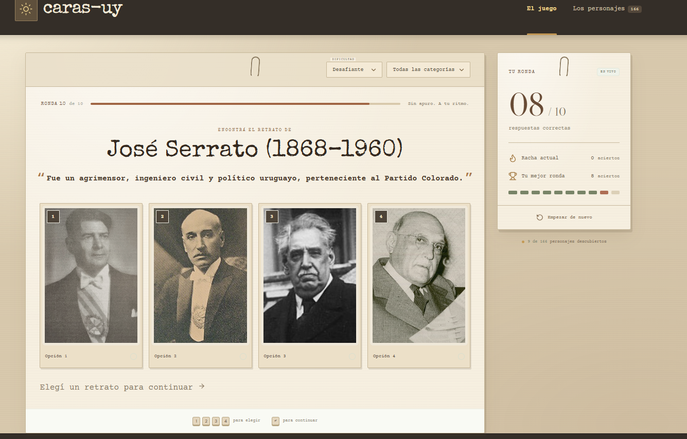

Esta app surgió en una charla sobre [este proyecto](https://www.politicaspublicas.uy/), alguien decía que era como Wikipedia con gráficos lindos.
Siempre tuve algo con las caras y los nombres, y me di cuenta de que no tengo las caras de los famosos de la historia uruguaya (tipo pre 1950). Entonces la idea fue armar un quién es quién con los datos de Wikipedia de personalidades Uruguayas. [Jugá acá](https://caras-uy.netlify.app/)

[{fig-alt="Captura de caras-uy con cuatro retratos y el puntaje de la ronda."}](https://caras-uy.netlify.app/)
