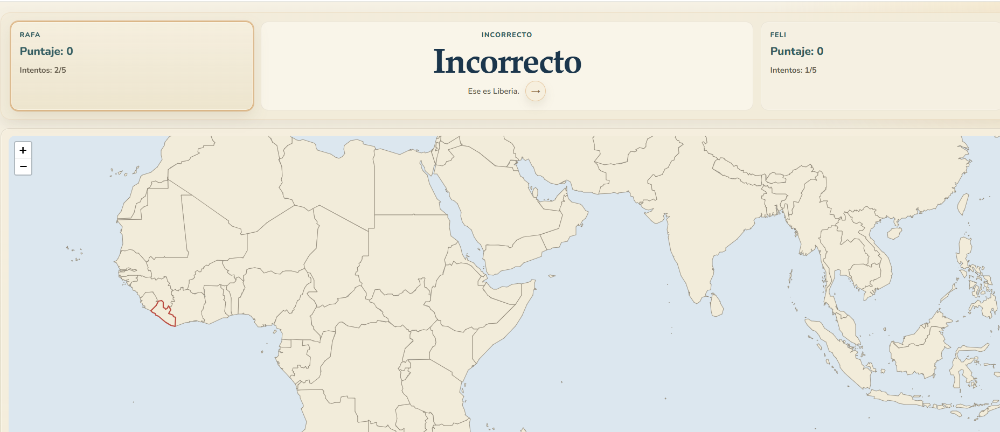

El otro fin de semana, mi hijo me hizo una pregunta: ¿cuáles son los países vecinos de India? Hace tiempo que quiero hacer un juego de Geografía, así que [decidí vibe codearlo]:

Armé una aplicación React, con un dataset de geografía y al poco rato estábamos jugando. Antes del *vibe coding*, armar esto me habría llevado un montón de horas. Codex permite tener una primera versión y probar la idea con el cliente (mi hijo), ver qué nos divertía y empezar a imaginar qué podía mejorar.

Hace poco escuché a Jeremy Howard hablar de cómo el vibe coding aliena al programador del código que produce. En esa misma charla defendía el valor de los notebooks: permiten interactuar directamente con los objetos que tenemos en la memoria de la computadora.

Cuando trabajo con código que escribí y conozco, puedo seguir su lógica, inspeccionar sus partes y entender por qué algo falla. Si delego buena parte de esa escritura, esa familiaridad no aparece por arte de magia.

Pero programando con Codex, paso mucho tiempo mirando el producto que el código. Jamás fui de esos programadores que piensan en cada línea de código que escriben como si fuera un cuento de Borges (aunque Borges fue gran razón por la por lo que aprendí a programar)

La verdad es que prefiero no dedicar tanto tiempo a conectar herramientas y organizar componentes.

Howard explica que el vibe coding es una mala experiencia de usuario, pero pone como ejemplo un bug en el kernel de IPython. Nada que ver con lo que yo hago en mi día a día.

## Future Work

La otra ventaja de iterar tan rápido es que liberamos tiempo para pensar en otros problemas. En este caso, la pregunta que me interesaba es: ¿cuál es la forma más eficiente de enseñar a reconocer países en un mapa?
La primera dinámica que pensé era bien simple, una definición por penales: la compu te dice un país, lo tenés que ubicar en el mapa. 5 chances para cada jugador, el que acierta más gana.

Una vez que tenemos el prototipo y lo usamos, es obvio que esa no es la dinámica óptima para que los jugadores aprendan del mapa. Pero es imposible darse cuenta sin probar la primera versión. Así que ahora es necesario enfrentar la verdadera pregunta: ¿cómo diseñar un bucle que mantenga a los jugadores enganchados, y les de feedback que vaya completando su modelo mental de la geografía del mapa?
